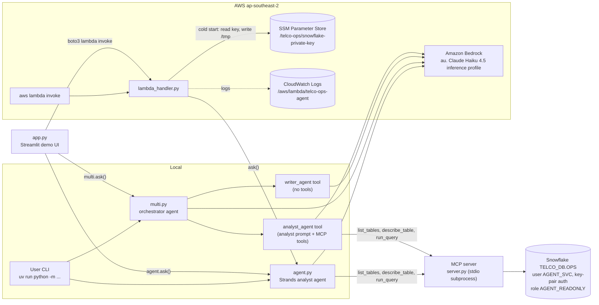

# telco-ops-agent

[](https://github.com/shyamzere/telco-ops-agent/actions/workflows/ci.yml)

An AI ops assistant for a telco network operations team. It answers plain-English questions about sites, incidents and tickets stored in Snowflake. A Strands agent on Amazon Bedrock (Claude Haiku 4.5) reads the data through a small MCP server, and it runs either locally or in AWS Lambda.

## Architecture



How the pieces fit:

- **[server.py](src/telco_ops_agent/server.py)** is a FastMCP stdio server with three tools: `list_tables`, `describe_table` and `run_query`. It opens a new Snowflake connection for each call.
- **[agent.py](src/telco_ops_agent/agent.py)** defines the Bedrock model, the analyst system prompt, `make_client()` and `ask()`. `make_client()` starts `server.py` as a subprocess with the current Python. The agent never connects to Snowflake itself.
- **[multi.py](src/telco_ops_agent/multi.py)** reuses the model, prompt and MCP client from `agent.py`. It wraps two agents as `@tool` functions: an analyst (with the MCP tools) and a writer (no tools, writes at most 3 sentences for a manager). An orchestrator agent calls the analyst, then the writer, and replies with the summary plus the SQL. Only the orchestrator streams output. `multi.ask()` runs one question end to end.
- **[app.py](app.py)** is a Streamlit demo UI and a front end for both paths. It calls `agent.ask()` or `multi.ask()` locally, or invokes the Lambda function with boto3. See [Demo UI](#demo-ui).
- **[lambda_handler.py](src/telco_ops_agent/lambda_handler.py)** runs the single analyst agent (`ask()`), not the multi-agent path. On a cold start it reads the private key from SSM, writes it to `/tmp/agent_key.p8` with `0600` permissions and sets `SNOWFLAKE_KEY_PATH`. It also sets `HOME=/tmp`, because the Lambda filesystem is read-only outside `/tmp`.

The same MCP server is registered for Claude Code in [.mcp.json](.mcp.json) as `telco-ops`.

### Terraform resources ([infra/](infra/))

- `aws_s3_bucket` (private, public access blocked) and `aws_s3_object` for the deployment zip
- `aws_lambda_function` `telco-ops-agent`: Python 3.13, x86_64, 1024 MB, 120 s timeout
- `aws_cloudwatch_log_group` `/aws/lambda/telco-ops-agent`, 7 day retention
- `aws_iam_role` and an inline `aws_iam_role_policy` (least privilege, see below)
- `aws_budgets_budget`: 5 USD per month, email at 80% actual and 100% forecast

State is local (`infra/terraform.tfstate`, gitignored). There is no remote backend.

### GitHub Actions CI ([.github/workflows/ci.yml](.github/workflows/ci.yml))

Runs on every push and pull request. Two jobs:

- **terraform**: `fmt -check`, `init -backend=false`, then `validate`. It creates an empty placeholder `build/lambda/lambda.zip` first, because `validate` evaluates `filemd5()` on it.
- **python**: `uv sync`, then `python -m compileall` on `src`, `scripts`, `app.py` and `hello.py`. No linter or tests are configured yet.

## Data

All data is fake. [sql/setup.sql](sql/setup.sql) generates it randomly in `TELCO_DB.OPS`, so counts and values differ between setups.

| Table | Rows | Columns |
| --- | --- | --- |
| `SITES` | 60 | `SITE_ID`, `SITE_NAME`, `REGION` (5 NZ regions), `TECHNOLOGY` (4G/5G) |
| `INCIDENTS` | 3000 | `INCIDENT_ID`, `SITE_ID`, `SEVERITY`, `CAUSE`, `START_TIME`, `DURATION_MINUTES` |
| `TICKETS` | 5000 | `TICKET_ID`, `SITE_ID`, `CATEGORY`, `CREATED_AT`, `RESOLUTION_MINUTES` |

Timestamps fall within the 90 days before the setup script ran.

**Timezone note.** Snowflake sessions default to US Pacific time (`America/Los_Angeles`). The fake sites are in New Zealand, so `server.py` sets `TIMEZONE` to `Pacific/Auckland` in the session parameters of every connection. Date-based logic such as "today", `CURRENT_DATE` or grouping by day therefore uses NZ dates, and timestamps come back in NZ time. The timestamp columns are `TIMESTAMP_LTZ`, so the stored instants do not change, only how they are shown and turned into dates. Rolling windows such as `START_TIME >= DATEADD('day', -7, CURRENT_TIMESTAMP())` give the same result in any timezone.

## Run locally

### Prerequisites

- Python 3.13 and [uv](https://docs.astral.sh/uv/)
- AWS CLI with credentials that can call Bedrock in `ap-southeast-2`, using the `au.anthropic.claude-haiku-4-5-20251001-v1:0` inference profile
- A Snowflake account (trial is fine) with `ACCOUNTADMIN`
- A Snowflake key pair for the `AGENT_SVC` user

### One-off Snowflake setup

1. Run [sql/setup.sql](sql/setup.sql) in a Snowsight worksheet as `ACCOUNTADMIN`. It grants `AGENT_READONLY` to the user `"shyamzere"` for testing, so change that name to your own. The final `DELETE` is expected to fail.
2. Generate a key pair. The private key goes to `~/.telco-keys/agent_key.p8` and the public key is printed:

   ```sh
   uv run scripts/gen_keys.py
   ```

3. Create the service user. `setup.sql` does not do this:

   ```sql
   USE ROLE ACCOUNTADMIN;
   CREATE USER IF NOT EXISTS AGENT_SVC
     TYPE = SERVICE
     DEFAULT_ROLE = AGENT_READONLY
     RSA_PUBLIC_KEY = '<paste the printed public key>';
   GRANT ROLE AGENT_READONLY TO USER AGENT_SVC;
   ```

4. The Snowflake account ID is hardcoded as `ACCOUNT` in [server.py](src/telco_ops_agent/server.py) and [scripts/test_snowflake.py](scripts/test_snowflake.py). Change both to your account.

### Environment variables

| Name | Needed | Used by |
| --- | --- | --- |
| `SNOWFLAKE_KEY_PATH` | Optional. Defaults to `~/.telco-keys/agent_key.p8` | `server.py`. `agent.py` forwards it to the MCP subprocess. `scripts/test_snowflake.py` ignores it. |
| `AWS_PROFILE` (or other standard AWS credential variables) | Only if you do not use the default profile | boto3, for Bedrock |

The Bedrock region is hardcoded to `ap-southeast-2` in `agent.py`.

### Install and check

```sh
uv sync
uv run scripts/test_snowflake.py   # Snowflake connection smoke test
uv run hello.py                    # Bedrock access check, no tools
```

### Ask questions

Single analyst agent. It prints the SQL it ran and a short answer:

```sh
uv run python -m telco_ops_agent.agent "Which region has the most critical incidents?"
uv run python -m telco_ops_agent.agent "Which cause leads to the longest critical incidents?"
```

Multi-agent orchestrator. It returns a manager summary of at most 3 sentences, then the SQL:

```sh
uv run python -m telco_ops_agent.multi "How many tickets about dropped calls were raised for 5G sites in Auckland in the last 30 days?"
```

With no question, both default to "Which region has the most critical incidents?".

To inspect the MCP tools on their own:

```sh
uv run mcp dev src/telco_ops_agent/server.py
```

## Demo UI

[app.py](app.py) is a small Streamlit chat page. Streamlit is in a separate `ui` dependency group, so it is not installed by a plain `uv sync` and is not included in the Lambda zip.

```sh
uv sync --group ui
uv run streamlit run app.py
```

Pick a mode in the sidebar:

| Mode | What it does |
| --- | --- |
| Single agent (local) | Calls `agent.ask()` on your machine. Same path as `python -m telco_ops_agent.agent`. |
| Multi-agent (local) | Calls `multi.ask()` on your machine. Same path as `python -m telco_ops_agent.multi`. |
| AWS Lambda | Invokes the deployed `telco-ops-agent` function in `ap-southeast-2` with `{"question": ...}` and a 150 s read timeout. Needs the Lambda deployed first. |

The sidebar also has four example questions. "Delete all closed tickets." shows the refusal. "What is the average ticket resolution time by priority?" should get an answer saying the data cannot tell, because `TICKETS` has no priority column. Each answer shows the mode and the elapsed time. Errors are shown as short messages, never stack traces.

The UI uses the same config as the CLI: the standard AWS credential chain and the optional `SNOWFLAKE_KEY_PATH`. It adds no secrets.

Note: a plain `uv sync` removes the `ui` group again. Use `uv sync --group ui` while you work on the UI.

## Deploy to Lambda

### 1. Build the zip

```sh
uv run python scripts/build_lambda.py
```

This exports the locked dependencies, installs Linux `x86_64-manylinux_2_28` wheels for Python 3.13 (binary only, no source builds), adds the `telco_ops_agent` package and writes `build/lambda/lambda.zip`. It warns if the unzipped size is over Lambda's 250 MB limit.

### 2. Store the private key in SSM (one-off)

```sh
aws ssm put-parameter \
  --name /telco-ops/snowflake-private-key \
  --type SecureString \
  --value "file://$HOME/.telco-keys/agent_key.p8" \
  --region ap-southeast-2
```

This is done outside Terraform on purpose. A Terraform `aws_ssm_parameter` resource, or even a data source, would store the decrypted key in Terraform state. Instead, [iam.tf](infra/iam.tf) builds the parameter ARN as a plain string. Leave out `--key-id` so the default `aws/ssm` KMS key is used, and no `kms:Decrypt` grant is needed.

### 3. Terraform

```sh
cd infra
cp terraform.tfvars.example terraform.tfvars   # then set budget_email
terraform init
terraform plan
terraform apply
```

`terraform.tfvars` is gitignored. The other variables have defaults in [variables.tf](infra/variables.tf). If you change the model in `agent.py`, also change `model_id` there.

### 4. Invoke

Create `build/payload.json` (gitignored) with the question:

```json
{"question": "Which region has the most critical incidents?"}
```

Then, from `infra/`:

```sh
aws lambda invoke --function-name telco-ops-agent --payload fileb://../build/payload.json --cli-read-timeout 150 --region ap-southeast-2 ..\build\out.json
```

`out.json` contains `{"answer": "..."}`, or `{"error": "..."}` if the question is missing. `--cli-read-timeout 150` is longer than the function's 120 s timeout, so the CLI does not give up first. Logs go to `/aws/lambda/telco-ops-agent` in CloudWatch.

## Security and privacy

- **Read-only Snowflake role.** The agent connects as `AGENT_SVC` with `AGENT_READONLY`, which has only `USAGE` and `SELECT` grants.
- **Query checks in `run_query`.** One statement only. It must start with `SELECT` or `WITH`. Any query containing a blocked keyword (`insert`, `update`, `delete`, `drop`, `grant`, `set` and others) is rejected. Results are capped at 100 rows, and statements time out after 30 s.
- **Write requests are refused at three layers.**
  1. Agent prompt: the analyst and orchestrator prompts say the data is read-only. If asked to insert, update, delete, create, drop or change anything, the agent politely refuses without calling any tool.
  2. `run_query`: only a single `SELECT` or `WITH` statement gets through, and blocked keywords are rejected.
  3. Snowflake role: `AGENT_READONLY` has no write grants, so a write would fail even if the first two layers missed it.
- **Fake data only.** Nothing in Snowflake is real customer or network data.
- **No secrets in code or state.** The private key lives in `~/.telco-keys/` locally (outside the repo) and in an SSM SecureString in AWS. It never enters Terraform state. `.env`, `terraform.tfvars`, state files and `build/` are gitignored.
- **Least-privilege IAM.** The Lambda role has one inline policy that allows:
  - `logs:CreateLogStream` and `logs:PutLogEvents` on its own log group only
  - `ssm:GetParameter` on the one key parameter only
  - `bedrock:InvokeModel` and `bedrock:InvokeModelWithResponseStream` on the Haiku inference profile, and on the Haiku foundation model in each destination region (`ap-southeast-2`, `ap-southeast-4`), each named explicitly with no region wildcard

  The trust policy only lets the Lambda service assume the role for this account (`aws:SourceAccount`).
- **Log retention** is 7 days. Terraform creates the log group before the function, so Lambda never creates one with no expiry.
- **CI** has no AWS credentials and no secrets. The workflow token has `contents: read` only. It never deploys.

## Business value for a telco ops team

- Faster triage. An engineer can ask "which sites had the most critical incidents this week?" and get an answer in seconds instead of writing a report.
- Plain-English access to incident and ticket data, without knowing SQL or the table layout.
- Answers show the SQL that produced them, so anyone can check the numbers.
- Short manager summaries from `multi.py`, built only from query results.
- Safe by design. The assistant can read data but cannot change it.

## Lessons learned

- **Secondary roles in a Snowsight worksheet bypassed the read-only role during testing.** Fix: `USE SECONDARY ROLES NONE;` before testing `AGENT_READONLY` (now in `setup.sql`).
- **mcp 2.x renamed FastMCP.** Fix: pin `mcp[cli]<2` in `pyproject.toml` and keep `from mcp.server.fastmcp import FastMCP`.
- **The MCP stdio client does not inherit the parent environment.** It only passes a small safe set such as `PATH` and `HOME`. Fix: `agent.py` forwards `SNOWFLAKE_KEY_PATH` explicitly through `SERVER_ENV_VARS`.
- **snowflake-connector in Lambda needs manylinux_2_28 wheels.** Fix: `build_lambda.py` installs with `--python-platform x86_64-manylinux_2_28 --only-binary :all:`.
- **Terraform `ignore_changes` still stores secrets in state.** Fix: create the SSM parameter with the AWS CLI and build its ARN as a string in Terraform.
- **Cross-region inference gave AccessDenied on ap-southeast-4.** Fix: get the profile's destination regions with `aws bedrock get-inference-profile` and allow the foundation model in each one (`bedrock_destination_regions`).
- **`terraform validate` evaluates `filemd5`.** Fix: CI creates an empty placeholder `lambda.zip` before validating.
- **Enabling IAM Identity Center on a Free plan account lost the credits.** Fix: do not enable it on this account.
- **Bedrock Anthropic models need the use case form submitted first.** Fix: submit the form in the Bedrock console before the first call.
- **Snowflake sessions default to US Pacific time, so date-based questions ("today", "per day", `CURRENT_DATE`) used US dates for NZ sites.** Fix: `server.py` sets `TIMEZONE = Pacific/Auckland` in the session parameters.

## Cost

Built to cost nothing:

- AWS Free plan credits cover the usage.
- A 5 USD monthly AWS budget alert is defined in Terraform.
- Lambda and Bedrock Haiku usage came to a few cents at most.
- Snowflake runs on trial credits. The XSMALL warehouse auto-suspends after 60 s, and a resource monitor suspends it at 5 credits per month.

## Teardown

```sh
cd infra
terraform destroy
aws ssm delete-parameter --name /telco-ops/snowflake-private-key --region ap-southeast-2
aws logs describe-log-groups --log-group-name-prefix /aws/lambda/telco-ops-agent --region ap-southeast-2   # should list nothing
```

The S3 bucket has `force_destroy = true`, so `destroy` removes it even with the zip inside.

In Snowflake:

```sql
ALTER WAREHOUSE TELCO_WH SUSPEND;
```

Then cancel the Snowflake trial.

## What I would do next

- Evaluation tests: a fixed set of questions with expected answers, checked against the SQL results.
- An API Gateway endpoint or a Step Functions workflow in front of the Lambda, so the demo UI does not need AWS credentials of its own.
- Compare the results with Snowflake Cortex Analyst on the same data.
